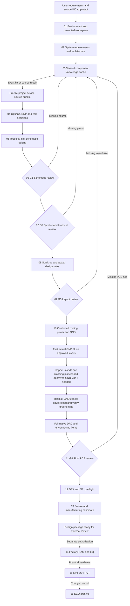

# R10 完整工程工作流：16 节点、G1–G4 与证据边界

**适用范围：**新建或既有 KiCad 项目；本文状态对应 R10 的 Konnect 单写者迁移。主 AI 设计流程止于 `DESIGN_PACKAGE_READY_FOR_REVIEW`，它只是一个*汇总标签*（并非脚本生成的工厂放行）。节点 14–16 是外部的、需单独授权的生命周期活动。本文档覆盖 `full-workflow.md` 中与之冲突的历史描述；`konnect-capability-migration.md` 中的现行单写者规则覆盖遗留的 `pcbnew` 编辑指引。

## 架构与权责



| 角色 | 必须执行的动作 | 禁止的捷径 |
|---|---|---|
| **AI 与工程师** | 以工程师为后盾的需求、约束推理、执行计划、风险处置 | 编造数据手册数据、测量值、签名或验收 |
| **Python** | 只读提取、器件缓存校验、几何与网络算法、不可变证据 | 把仿真走线当作真实铜箔，或静默编辑活动板 |
| **Konnect MCP** | 所有经授权的*活动 EDA 编辑*，通过动态发现、风险分级与范围受限的验收来选择 | 并发写入、未经验证的回退与不限次数的重试 |
| **KiCad 原生 CLI** | 独立重新加载已保存项目、运行 ERC/DRC、校验原生网表与制造文件 | 假装零 DRC 错误即可证明 SI/PI、热/EMC 或工厂批准 |

操作活动工作项目时：核实其路径、修订与 UUID/网络目标，保持唯一写者，小批量提交，读回，保存，移交写者，并独立核验已保存状态。出现超时或不一致时，先检查状态再考虑重试。离线设计生成器只能写入一个独立的、未被并发打开的候选。遗留 `pcbnew` 仍可作为受限的只读兼容选项；旧的默认 `pcbnew` 铺铜填充写者已停用。

## 器件知识可共享；工程验收不可共享

使用一个持久的外部 `device-cache/`，其中保存原始对象、提取文本、来源修订、卡片、证据与精确匹配登记表。按**厂商 + 精确 MPN + 封装**匹配，并结合项目特定的参考/应用/工作条件。先运行 `resolve`。使用已验证的命中，随后 `audit`，再生成项目专属 `bundle`；只修复缺失/过期的文档种类。`AMBIGUOUS` 与 `INVALID_CACHE_ENTRY` 一律阻断。不得静默改选邻近料号，也不得只把过期日期改新。

一张已验证卡片需要文档 SHA、修订版、原始定位/页码、工程条件与真实评审证据。复用 `brief`，让 AI 只看到相关行。插图、脚注、含糊参数、特殊模式与缺失覆盖仍需阅读冻结的原始资料。公开的 Skill 归档中绝不可包含厂商 PDF、客户私有设计或不可公开的授权文档。

| 闸门 | 复用的卡片类型 | 每个项目必须执行的检查 |
|---|---|---|
| G1 / 06 | 推荐电路、电源、上电启动、复位、时钟、接口 | 实际引脚/网络连通性、ERC、原理图目视检查与工程师评审 |
| G2 / 07 | 引脚定义、焊盘映射、焊盘图形、EP、极性与封装 | 真实的符号-封装编号对应、资源锁定与装配变体 |
| G3 / 09 | 去耦、晶振、RF、热、摆放与回流路径指引 | 真实板几何、关键器件、机械间距与布线通道 |
| G4 / 11 | 高速路径、层、参考平面、过孔/扇出、RF 与回流指引 | 全部真实铜箔、网表一致、原生 DRC、AI 与工程师签核 |

`STAGE_CARD_COVERAGE_INCOMPLETE` 意味着回到节点 03，补充有来源依据的特定内容。它不是跳过闸门或重新下载整本手册的理由。来源或项目变更会各自使其依赖的证据失效。

## 逐节点执行

### 01 — 环境与项目保护（`environment`）

**输入：**真实的 `.kicad_pro`、`.kicad_sch` 与可选的 `.kicad_pcb`；已安装的 KiCad CLI、已授权的 Konnect 后端与当前项目索引。**方法：**先运行一次轻量目标连接；新安装或要求深度校验时使用 doctor/setup。校验可执行文件身份、当前 KiCad 版本、选定板卡路径与允许的 MCP 范围；注册唯一权威工作区。**闸门：**不受支持或错误的板卡即为 `BLOCKED`；连接查询不会创建板卡、编辑用户文件或批准量产。

### 02 — 产品需求与系统架构（`requirements`）

**输入：**功能需求、供电/电流与瞬态负载、接口电压、时钟、尺寸、温度、可靠性与成本约束。**方法：**用 `project_flow.py` 与 `system_integration.py` 把功能映射到框图、电源树、接口矩阵、信号流，以及可度量的「需求→来源→测试」条目。**闸门：**缺失值与未知需求保持未决，绝不臆造。**输出：**架构、显式约束、验收矩阵与持续跟踪的开放问题。

### 03 — 官方厂商证据与可复用器件缓存（`sources`）

**输入：**厂商、精确 MPN、封装、参考、应用、所需文档种类与新鲜度策略。**方法：**离线运行 `device_knowledge.py resolve`，选择已验证的来源卡片，执行来源审计并冻结项目资料包。仅对缺失/过期的种类，获取并实际查阅厂商数据手册、勘误表、参考布局或应用笔记；登记带原始证据哈希的修订卡片。**闸门：**不匹配、过期校验、来源 SHA 不一致或不受支持的应用条件一律阻断。**输出：**来源资料包与简短、可核验的逐器件卡片。

### 04 — 备选方案、DNP 与风险管理（`reserve`）

**输入：**架构、器件采购、默认装配状态、诊断/测试接入点、拟议的 0 欧姆/选择器/跳线/后备电路。**方法：**`reserve_review.py` 记录已纳入与已舍弃选项的理由、装配变体、互斥装配组与真实风险。**闸门：**不得插入无说明的占位；对装配与 DNP 两种状态都测试残桩残留、电源短路、敏感耦合以及制造/装配约束。

### 05 — 拓扑优先的原理图创建（`schematic`）

**输入：**有来源依据的精确符号、电源树、当前网络拓扑、跨页端口与设计意图。**方法：**在最终摆放符号之前先求解模块/网络与布线走廊；在已授权的工作项目中使用经验证的 Konnect 原理图操作，或用 `schematic_candidate.py` 首次生成隔离候选。生成*原生* KiCad XML 网表。**闸门：**核验真实符号引脚、层次化/网络标号、NC 处理、复位/BOOT、使能、去耦与接口；图形相碰不能证明连接。不得断言存在通用的自动原理图绘制引擎。

### 06 — G1 独立原理图评审（`schematic_review`）

**输入：**已保存原理图、原生网表/ERC、冻结的厂商资料包、需求与布局/目视证据。**方法：**`static_review.py --stage schematic` 生成简短的 `device-knowledge-brief.json`、当前网络事实、真实的厂商来源定位与图核对任务。AI 将电源、时序、时钟、复位、上电启动与外部接口逐一与实际电路比对。**闸门：**原生 ERC、评审报告、当前修订绑定与真实工程师签名彼此独立。未解决的阻断性风险或不受支持的观点将中止 G1；不进行第二次全量数据手册下载。

### 07 — G2 符号/封装/引脚映射（`footprints`）

**输入：**已确认的原理图、冻结的精确器件卡片、KiCad 符号与封装库文件、引脚/焊盘映射表以及 `resource_lock`。**方法：**对可信资源做哈希锁定，调用 `resource_guard.py check --review-config` 复用引脚定义/焊盘图形知识。核查每个物理焊盘/符号引脚编号、电气类型、1 脚标记、裸露焊盘、极性、NC 引脚与装配变体。**闸门：**未改动的库不一定是正确的厂商库。缺失覆盖回到节点 03；当前封装不匹配则阻断 G2。

### 08 — 叠层与生效制造规则（`stackup`）

**输入：**与原理图同步的真实 PCB、板厂认可的层叠、铜/介质、过孔/钻孔能力、孔环、板边间距、阻抗/差分与电流限制。**方法：**汇编 `design_intent.py` 规则候选，经认可的 EDA 写者保存，并用 `design_intent_audit.py` 读回实际生效的层、NetClasses/自定义规则与网络覆盖情况。若具备条件，在隔离测试板上运行违例夹具，证明目标 DRC 规则确实触发。**闸门：**仅存在 JSON 条目不能证明原生规则已生效；不受支持的约束显式阻断。

在 G3 之前，提供 JLCPCB 2/4/6/8 层保守制造参数档，**展示全部数值并取得用户明确确认**。保存与参数档/板卡/来源绑定的不可变批准；随后由 Konnect 设置实际的 KiCad 叠层、Board Setup 与 NetClasses，且必须独立读回。参数档/层数/厚度变更意味着重新确认，而不是绕过。参见 [JLCPCB 用户确认](jlcpcb-fab-confirmation.md)。

### 09 — G3 摆放与物理布局评审（`placement`）

**输入：**当前 PCB、G2 资源映射、板框与约束、XML 网表、关键器件摆放卡片。**方法：**先锚定连接器、孔与机械限制；在追求美观整理之前，先摆放电源环路、晶振、RF、敏感模拟与高速引出路径。在能力允许处，Konnect 执行已认可的移动操作，**保存并读回真实封装位置**。`pcb.placement_pre` / `placement_review.py --phase pre_route --review-config` 检查当前真实元件/焊盘、Courtyard、机械禁布区、关键引脚级摆放规则与预拟布线走廊。**G3 是仅针对布局的闸门：不要调用整板 KiCad DRC，也绝不在布线前要求零未连网络。**出现飞线是正常的。评估布线可行性、回流路径拓扑、可制造性与机械可达性；焊盘中心距离不能证明电流回流路径已经闭合。该 Python 检查器本身不执行自动摆放或原生 DRC。

### 10 — Freerouting 优先的七阶段布线与地铺铜收尾（`routing`）

本节点是**当前 R10 契约**（取代较早的 Konnect 全局 A* 布线描述）。在任何外部执行之前，先阅读 [`freerouting-seven-stage.md`](freerouting-seven-stage.md) 与 [`routing_policy.py`](../scripts/routing_policy.py)。**现有软件阶段只是只读计划与有限的已保存板卡审计；实时 SES 导入与原生校验仍需经过认可的 KiCad/Konnect 操作。**

1. **对每个实际网络分类（P0–P4）**：绑定原始已保存板卡、全部 XML 网表名称、真实 `(ref,pin)` 对、未连接项、电流、关键性与 GND 策略。未知的网络/分类/板厂数据一律阻断。
2. **应用并重读真实原生规则**：确认认可的叠层、可用层、走线宽度、电流/热/压降最小值、电源主走线 +0.254 mm 余量、铜间距、板边、过孔钻孔/尺寸、45 度普通走线策略、限制项与生效的 KiCad NetClass 归属。仅有来源 JSON 不构成已应用的规则。
3. **优先布线关键 P0–P2 网络**：RF/阻抗、差分/长度敏感、大电流电源、Kelvin、时钟与开关环路只能使用经认可的 Konnect/KiCad 实时写者；保存/读回并保留关键铜箔/封装/对象 ID。只有有来源依据、有界的焊盘引出颈缩才允许改变局部宽度。
4. **用 Freerouting 2.5.0 布通普通 P3 网络**：在**关键**走线受到保护之后，导出全新 DSN，绑定精确输入 SHA、外部认可的 `.rules` SHA 与固定版本的布线器 JAR 身份；`-inc` 排除**专用 GND 与所有受保护的 NetClasses**（绝不排除任意网络名）。输出的 `.ses` 只是候选结果。不做任何未经验证的实时编辑器改动。
5. **导入隔离的 KiCad 候选并审计**：通过认可的 Konnect/KiCad 工具导入 SES，保存/重载并检查全部实际新增走线/过孔与受保护铜箔的差异；运行 `routing_seven_stage.py audit-import` 校验最小宽度、H/V/45 度普通几何、层/过孔限制、来源哈希与网络一致性。若出现未知/不受支持的几何或网络映射：BLOCKED。
6. **有界修复**：对明确剩余的网络重新规划，限定时间/迭代/过孔次数与白名单内的拆线重布；绝不静默放宽厂商最小值、防短路规则、参考平面、高速、电流或颈缩限制。任何编辑或超时之后重新校验；没有合格操作者时转交工程师处理。
7. **GND 铺铜与完整 G4 证据**：地走线自动布线保持关闭；补充所需的回流/缝合过孔，重新填充真实 GND 铜箔，保存/重载，然后运行包含全部所需未连接项的原生整板 KiCad DRC。随后进行项目特定的 SI/PI、热、制造、AI 与工程师评审；`routing_seven_stage.py audit-final` 只是额外的只读检查，**不是**原生 DRC 执行器，也不是 G4 验收依据。

**G3 边界：**摆放阶段不做抢先的整板 KiCad DRC，也不要求零未连接项。**G4 边界：**整板 DRC 与最终连通性只能在 [GND 首次铺铜 →（如需）认可的接地缝合 → 二次铺铜 → DRC 前 GND 审计](gnd-before-drc.md)之后进行；生成 SES 或一份绿色的规划报告都不构成批准。

### 11 — G4 最终已保存 PCB 评审（`pcb_review`）

**输入：**最终保存的 PCB（**已布线、完成首次 GND 铺铜、经评审、如需已缝合、随后再次重铺**）、绑定来源的 `ground-pre-drc` 通过回执、原生 **G4 整板 DRC（含未连接项）**、当前网表/约束/叠层、分层渲染图、铺铜回执与冻结的器件资料包。**方法：**`static_review.py --stage pcb` 按 SHA 复用来源卡片与已验证缓存文本。AI 检查每个铜层、去耦、关键路径、过孔、RF/天线、回流/接地、机械与可制造性问题。闸门重新计算来源与板卡基线，核验原生检查，并要求工程师评审。**闸门：**仅凭原生 DRC 无法确立实际阻抗、SI、EMI/EMC、可靠性或最终产品测试结论。`NEEDS_EVIDENCE` 不能因为 AI 摘要简短就变成 PASS。

### 12 — DFX/NPI 导出前检查（`npi`）

**输入：**当前 G1–G4 检查结果、板厂工艺、装配变体 BOM/CPL、PCB 几何与 DFM/DFT 约束。**方法：**`mass_production_review.py` 检查完整的原生制造与装配约束、来源/证据新鲜度，以及适用的关键电源/高速/安全项。**闸门：**不完整、过期或不匹配的检查不等于制造就绪；缺失的物理测试仍是显式的外部证据要求。**输出：**风险与待工厂答复的问题。

### 13 — 冻结的制造候选（`manufacturing`）

**输入：**已评审项目、已保存 PCB、认可的约束、相关 G1–G4 与 NPI 证据、精确 BOM 变体。**方法：**创建新的独立来源候选，调用经*夹具验收*的 Konnect 铺铜/保存操作并保留回执，独立使用 KiCad CLI 原生重载/DRC；导出 Gerber、Excellon 钻孔、BOM/CPL 与图纸；构建精确的产物 SHA 清单。**闸门：**导出成功仅意味着 `EXPORTED_NOT_RELEASED`。可供外部评审的设计包**不是**已获授权的工厂量产放行。

### 14 — 工厂 CAM、EQ 与量产批准（`cam_release` — 外部）

只有实际工厂与获授权工程师才能评审真实的 Gerber/钻孔/装配、叠层、拼板、阻焊/钢网、阻抗与 EQ 闭环。AI 可以准备检查清单并跟踪答复，但绝不伪造 CAM 批准或授权量产。

### 15 — 样机评估（`prototype` — 外部）

硬件工程师使用真实样机与仪器，按需执行实际上电、功能、接口、热、EMC、环境与可靠性测试。AI 可以协助分析证据，不得虚构测量数据或宣布认证通过。

### 16 — ECO 与归档（`eco` — 外部）

识别受影响的器件卡片、需求、网络、封装、铜箔、装配与制造输出。保留既往发布物与原始哈希。重跑受影响的 KiCad ERC/DRC、G1–G4、制造评审与真实物理测试；由工程师独立批准新修订版。

## 故障处理

| 情形 | 正确恢复方式 | 不安全捷径 |
|---|---|---|
| 缓存 `MISS` | 仅补取缺失的文档种类，然后校验并登记 | 重新下载全部文档或凭空推断数值 |
| `STALE`、勘误或来源哈希变更 | 重新核对实际修订与受影响的项目设计 | 只刷新一个校验日期 |
| `AMBIGUOUS`、`INVALID_CACHE_ENTRY` | 阻断并解决确切的身份/哈希/条件冲突 | 自动改选相似 MPN |
| 阶段卡片覆盖缺口 | 在节点 03 核验特定来源章节 | 无视缺失的 G2/G3/G4 证据 |
| GUI/磁盘不一致 | 停止写入，保存/重载并绑定当前候选 | 用过期的 Python 内存覆盖 GUI 中的板卡 |
| 缺少 Konnect 操作 | 阻断，或在使用前完成一次夹具验收 | 切换到未经验证的写者 |
| ERC/DRC 违例 | 修复真实工程设计，重跑原始检查 | 改规则或删器件来拼凑 PASS |
| 输入、工具或板卡哈希变更 | 视情况使受影响证据与候选失效并重建 | 在旧签核包内替换已记录的哈希 |
| 缺少人工批准 | 保持评审挂起 | 模拟工程签核 |

## 常用命令

```bash
python scripts/workflow.py workspace /project --action status
python scripts/workflow.py modules --intent schematic
python scripts/workflow.py status /project --bundle control-r1 --format compact
python scripts/workflow.py run /project --task architecture.sources_resolve --device-cache /shared/device-cache --device-inventory device-inventory.json
python scripts/device_knowledge.py --cache /shared/device-cache bundle --requirements /project/resolved-device-requirements.json --output /project/device-sources-r1 --apply
python scripts/resource_guard.py check /project --lock resource-lock.json --review-config /project/static-review.json
python scripts/placement_review.py /project --policy placement-plan.json --netlist actual-netlist.xml --board actual-board.kicad_pcb --phase pre_route --review-config /project/static-review.json --output-dir /project/03_REPORTS/layout-r1
python scripts/static_review.py /project --config /project/static-review.json --stage schematic --output-dir /project/03_REPORTS/G1-r1
python scripts/static_review.py /project --config /project/static-review.json --stage pcb --output-dir /project/03_REPORTS/G4-r1
```

## 脚本不能证明什么

这是一个以证据为支撑的编排系统，不是通用的完整原理图/PCB 设计器、高级场求解器、SI/PI/EMC 测试仪器或工厂。`placement_review.py` 仍是只读检查器，离线 A* 只是走线*提案*，部分 `pcbnew` 只读几何仍需等效性验证。R10 的离线软件测试与历史 KiCad 测试不会自动认证当前机器上的商业 Konnect GUI 或某项量产设计。外部硬件测试、工程师签核、来源授权与适用的行业要求仍然强制。
